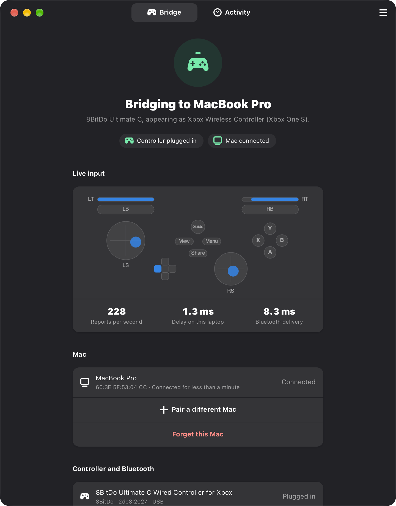

# PadBridge Host

PadBridge turns a Linux laptop into a Bluetooth game controller for a Mac. Plug a wired controller (for
example an 8BitDo Ultimate C) into the laptop, and your Mac sees a native Xbox or PlayStation controller
over Bluetooth. Games, Steam and Apple's Game Controller framework all work with it.

PadBridge Host is the Linux side: a background service that runs the bridge engine, and an app to watch and
control it.



## Requirements

- Fedora 43 with GNOME (other systemd distributions should work but are untested)
- A Bluetooth adapter and a wired controller on USB
- While PadBridge is set up, this laptop's own Bluetooth keyboards, mice and headphones don't work. The
  engine needs the Bluetooth HID channels for itself. Uninstalling restores them.

## Install

From the PadBridge folder (a release tarball, or `padbridge/host` in the source tree):

```sh
sudo ./install.sh
```

Then log out and back in once (the installer adds you to the `padbridge` group) and open **PadBridge** from
the app grid.

Options: `--identity xbox-one|ds4` picks what the Mac sees (default: what Bluetooth is already set up as, else
`xbox-one`), `--user NAME` picks the desktop user, `--force` stops an engine you started by hand,
`--setup`/`--no-setup` force or skip the Bluetooth setup (by default it runs only when Bluetooth isn't already
set up as that identity, so an upgrade doesn't restart Bluetooth). Run `./install.sh --help` for details.

If you ran the engine by hand before (`~/ds4-bt-bridge`), the installer takes over its pairing
(`ds4_bt_host.txt`, `ds4_bt_keys.json`), so your Mac doesn't need to pair again.

The installer:

| What | Where |
|---|---|
| App, service and a vendored copy of the engine | `/opt/padbridge/` (engine in `/opt/padbridge/engine/`) |
| Settings | `/etc/padbridge/config.json` (kept when you reinstall) |
| Service | `/etc/systemd/system/padbridged.service`, enabled and started |
| Access | group `padbridge`; your account is added to it |
| App entry and icon | `/usr/share/applications/io.padbridge.Host.desktop`, hicolor icons |
| Command-line tools | `/usr/local/bin/padbridge-host`, `/usr/local/bin/padbridgectl` |
| Bluetooth setup | runs the engine's `ds4_bt_setup.sh` for the chosen identity when needed (Bluetooth restarts) |
| Pairing | `/opt/padbridge/engine/ds4_bt_host.txt` and `ds4_bt_keys.json` (root only), kept on upgrade |

To make a release tarball with the engine bundled: `./build.sh` writes `dist/padbridge-host-<version>.tar.gz`.

## Use

1. Plug the controller into the laptop.
2. On the Mac, open **System Settings > Bluetooth**, find the controller under Nearby Devices and click
   **Connect**. No code is needed. The app shows the exact name to look for.
3. From then on PadBridge reconnects to that Mac by itself whenever the Mac is awake with Bluetooth on.

The app shows:

- **Status**: whether the controller is plugged in, whether the Mac is connected, and what the Mac sees,
  for example "8BitDo Ultimate C, appearing as Xbox Wireless Controller (Xbox One S)".
- **Live input**: sticks, triggers and buttons as the Mac receives them, with reports per second, the delay
  on this laptop (controller event to Bluetooth), and Bluetooth delivery (report handed to the radio until the
  radio confirms it; hover for the slowest 1%).
- **Mac**: the paired Mac, **Pair a different Mac**, **Forget this Mac**.
- **Controller and Bluetooth**: the physical controller (name, vendor, USB IDs) and the name your Mac lists.
- **Appear as**: Xbox Wireless Controller (Xbox One S, recommended) or DualShock 4, both over Bluetooth
  Classic. (Xbox Series X|S over Bluetooth Low Energy is paused for now.) See "Switching identity" below.
- **Power**: **Keep bridging with the lid closed** and **Start with this laptop**.
- **Advanced**: reports per second, and whether this laptop's own apps also see the controller.
- **Activity**: everything the service and the engine logged, with **Copy all** for bug reports.

The main menu has **Restart bridge** (Ctrl+R) and **Stop bridging** / **Start bridging**.

### Switching identity

1. Choose the identity under **Appear as** and confirm. PadBridge stops, sets up Bluetooth again and forgets
   the Mac on this side.
2. PadBridge then **stays stopped**: if it ran now, the Mac would reconnect to the old device straight away.
   On the Mac, open **System Settings > Bluetooth**, click the Info button next to the controller, then
   **Forget This Device**.
3. Back in PadBridge, click **I've forgotten it** (or **Start bridging**).
4. On the Mac, find the controller under Nearby Devices and click **Connect**.

macOS keeps the name it had for the device until it forgets it. After DualShock 4 mode the Mac may list the
device as "DUALSHOCK 4 Wireless Controller"; Forget This Device clears that.

From the command line: `padbridgectl identity ds4`, forget the device on the Mac, then `padbridgectl start`.

### Command line

```sh
padbridgectl status            # or: status --json
padbridgectl stop | start | restart | forget
padbridgectl identity xbox-one # or ds4; then forget on the Mac and run: padbridgectl start
padbridgectl set lid_closed=true rate=250 grab=true inflight=2
padbridgectl set name='"Couch Pad"'   # Bluetooth name for the Mac (name=null: the controller's own name)
padbridgectl boot on|off       # start with the laptop
padbridgectl log -f
journalctl -u padbridged -f    # the service's own log
```

### Keep bridging with the lid closed

Off by default. When on, and while PadBridge is bridging, the service holds a systemd-logind inhibitor lock
(`handle-lid-switch:sleep:idle`, mode `block`, shown by `systemd-inhibit --list` as "PadBridge"). It releases
the lock when you turn the option off or stop bridging, and when the service stops.

How this interacts with GNOME (checked against gnome-settings-daemon's `gsd-power-manager.c`):

- Closing the lid: logind, not GNOME, suspends the laptop. gsd-power only takes its own lid lock while an
  external monitor is connected, and never suspends on lid close itself. logind always honours a
  `handle-lid-switch` block lock (whatever `LidSwitchIgnoreInhibited` says), so a closed lid does nothing.
  GNOME may still lock the screen; that doesn't affect bridging.
- Automatic suspend when idle: gsd-power asks logind to suspend; the root-held `sleep` lock makes logind
  refuse unless the caller may override inhibitors (polkit `org.freedesktop.login1.suspend-ignore-inhibit`,
  admin-only by default).
- Suspend chosen by hand from the system menu still works.

While the engine runs, the service also sets the Bluetooth adapter's and the controller's USB devices to
`power/control = on` (no USB autosuspend), and restores the previous values when it stops.

Keep the laptop plugged in: a closed laptop that never sleeps drains its battery.

## Uninstall

```sh
sudo /opt/padbridge/uninstall.sh       # or ./uninstall.sh from the PadBridge folder
```

This stops and removes the service (releasing any inhibitor), forgets the paired Mac, runs
`ds4_bt_setup.sh --undo` (bluetoothd, `/etc/bluetooth/main.conf` and WirePlumber back to normal), and removes
every file the installer added and the `padbridge` group. On the Mac, forget the controller in Bluetooth
settings.

## Troubleshooting

| You see | Do this |
|---|---|
| "Log out to finish setup" | Your account just joined the `padbridge` group. Log out and back in. Check with `id -nG`. |
| "PadBridge's service is stopped" | Click **Start service**, or `sudo systemctl start padbridged`. If it stops again: `journalctl -u padbridged -b`. |
| "The bridge stopped" with "cannot bind HID channels" | Bluetooth isn't set up for PadBridge, or something else owns the HID channels. Pick an identity again in **Appear as**, or rerun `sudo ./install.sh`. Make sure no hand-started engine is running (`pgrep -af ds4_bt`). |
| "Plug in your controller" | Check the cable. `grep -A4 2dc8 /proc/bus/input/devices` should list it. |
| Waiting for your Mac forever | Wake the Mac and turn its Bluetooth on. If you switched identity, forget the controller on the Mac and pair again. |
| The Mac shows the old name or identity | macOS caches it. Stop bridging, forget the device on the Mac, start bridging, then connect again. |
| Every reconnect fails after a reboot | The engine restores lost pairings from `ds4_bt_keys.json` (look for "restoring it" in Activity). If that fails, forget on both sides and pair again. |
| The laptop still suspends with the lid closed | Check `systemd-inhibit --list` shows PadBridge while bridging, and `journalctl -b -u systemd-logind` after closing the lid. Report both. |
| Controller works on the Mac but also moves things on this laptop | Turn off **Let this laptop use the controller too**. |

## How it works

```
 GUI (GTK 4 + libadwaita, user)      padbridgectl (user)
            \                        /
             JSON lines over /run/padbridge/control.sock   (0660 root:padbridge + SO_PEERCRED check)
                          |
               padbridged (root, systemd)
               - runs the engine, restarts it with backoff (1, 2, 4, 8, 15, 30 s)
               - reads /run/padbridge/status.json (engine writes it twice a second)
               - logind inhibitor, USB autosuspend, ds4_bt_setup.sh, bluetoothctl, systemctl
                          |
               engine: python3 /opt/padbridge/engine/ds4_bt_bridge.py --status-file ... --mode xbox-one|ds4
                       --rate N --inflight N [--name NAME] [--no-grab]
```

Control socket commands: `status` (engine status merged with service state and settings, plus new log
lines since `log_since`), `set_settings`, `start`, `stop`, `restart`, `forget`, `apply_identity`, `set_boot`,
`ping`. Each request is one JSON object per line with `cmd` and an optional `id`; each reply is
`{"id", "ok", "result" | "error"}`.

The identity picker is built from the engine's `identities` list; status keys beyond the original set
(`controller.name`, `identity`, `identities`, `bt_name`, `link_ms`, …) are used when present and optional.
"Forget" stops the engine first and removes the Mac from `ds4_bt_host.txt`, `ds4_bt_keys.json` (otherwise the
engine would restore the pairing at its next start) and BlueZ.

## Development

Everything runs unprivileged against a mock engine, including on macOS with Homebrew
(`brew install gtk4 libadwaita pygobject3 adwaita-icon-theme`):

```sh
export PADBRIDGE_RUN_DIR=/tmp/pb PADBRIDGE_CONFIG_DIR=/tmp/pb-etc PADBRIDGE_ENGINE_DIR=/tmp/pb-engine
mkdir -p $PADBRIDGE_ENGINE_DIR
python3 bin/padbridged --fake-system --engine mock/mock_engine.py &   # MOCK_SCENARIO=normal|nocontroller|nomac|bindfail|crash|hang
python3 bin/padbridge-host
python3 -m unittest discover -s tests -v
```

`--fake-system` records Bluetooth, systemd and sysfs changes instead of making them and fakes the logind
inhibitor. `MOCK_LEGACY=1` makes the mock leave out the newer status keys.
Screenshot helpers: `PADBRIDGE_DEV_PAGE=activity`, `PADBRIDGE_DEV_SCROLL=<px>`, `PADBRIDGE_DEV_SIZE=WxH`,
`PADBRIDGE_DEV_DIALOG=switch:<id>|repair:<id>|pair|forget`, and `ADW_DEBUG_COLOR_SCHEME=prefer-light`.

Layout:

```
padbridge/config.py   paths, settings, identities          padbridge/daemon.py   the service
padbridge/system.py   setup script, bluetoothctl, systemctl, sysfs (real and fake)
padbridge/inhibit.py  logind inhibitor (dbus-python, falls back to systemd-inhibit)
padbridge/client.py   socket client                         padbridge/ctl.py      padbridgectl
padbridge/gui/        app.py, window.py, visualizer.py, link.py (worker thread), style.css
bin/                  launchers         data/   unit, desktop file, icons
mock/mock_engine.py   stand-in engine   tests/  service tests
```
